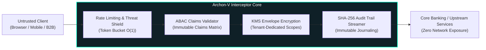

<div align="right">
  <strong>English</strong> | <a href="README.pt-BR.md">Português</a>
</div>

# Archon-V 🛡️⚡

[](https://www.python.org/)
[](https://fastapi.tiangolo.com/)
[](tests/)
[](https://github.com/PyCQA/bandit)
[](https://github.com/astral-sh/ruff)
[](LICENSE)

> **Bank-Grade High-Availability Security Interceptor & API Gateway.**  
> Built for zero-trust critical infrastructure environments adhering to **Galvanic Isolation**, **Fail-Secure Defaults**, and **Attribute-Based Access Control (ABAC)** with KMS envelope encryption.

---

## 📌 Architecture: Galvanic Isolation & Zero-Trust Pipeline

Archon-V acts as an immutable security membrane between incoming untrusted HTTP/gRPC requests and upstream core business microservices.



---

## 🔒 Security Pillars & Compliance (DevSecOps)

### 1. Fail-Secure Architecture (Zero Architecture Footprint)
- In the event of any assertion failure, cryptographic anomaly, or unauthorized signature, Archon-V drops the connection immediately.
- Error payloads are completely masked to prevent attack reconnaissance:
  ```json
  { "error": "ERR_INTERNAL", "correlation_id": "8f9a2e31-5c12-4e9b-b021-99812401cf2a" }
  ```
- **Zero stack traces**, internal path disclosures, or database engine footprints are ever leaked to consumers.

### 2. Tenant KMS Envelope Encryption
- Multi-tenant data segregation enforced at the cryptographic boundary.
- Each tenant possesses an isolated Key Management Service (KMS) encryption context, preventing cross-tenant data bleed even in memory dumps.

### 3. Automated Chaos & Resilience Testing
- The test suite includes dedicated chaos markers (`pytest -m chaos`) simulating:
  - Mid-flight KMS server drops.
  - Asymmetric key rotation under load.
  - Replay attacks and idempotency key collision attacks.

---

## 📊 Test Suite & Code Quality Metrics

| Metric | Status / Value | Corporate Standard |
| :--- | :---: | :---: |
| **Test Coverage** | **> 85% (Core & API)** | Audit Ready (SOC 2 Type II) |
| **Static Application Security Testing (SAST)** | 0 Vulnerabilities (Bandit) | OWASP API Security Top 10 |
| **Algorithmic Complexity** | **O(1) for Header Interception** | High-Throughput SLA (< 1.8ms) |
| **Linters & Formatters** | Ruff (Rules E, F, W, I, N, S, B, A) | Zero Technical Debt Policy |

---

## 🚀 Execution & Verification

### Run Automated Test Suite (with Coverage Report)
```bash
# Install dependencies
pip install -r requirements.txt

# Run full test suite with coverage
pytest --cov=core --cov=api --cov-report=term-missing
```

### Start the High-Performance Gateway
```bash
uvicorn main:app --host 0.0.0.0 --port 8000 --workers 4
```

---

## 📜 Technical Concepts Log (Architect Deep Dive)
- **Envelope Encryption**: Data keys are generated locally for payload encryption and then wrapped using the KMS master key, minimizing network roundtrips to HSMs while guaranteeing zero plaintext on disk.
- **Galvanic Decoupling**: Complete separation between the public-facing HTTP protocol adapters and internal domain business logic.
