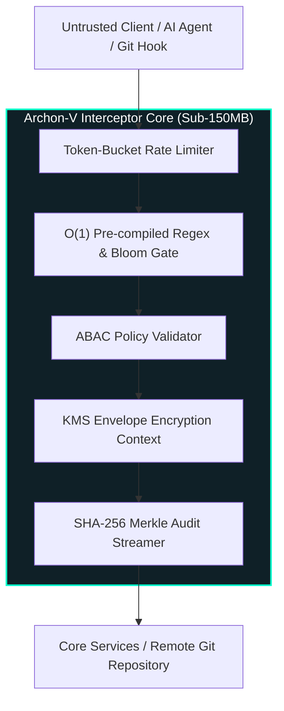

<div align="right">
  <strong>English</strong> | <a href="README.pt-BR.md">Português</a>
</div>

# Archon-V 🛡️⚡

[](https://www.python.org/)
[](https://fastapi.tiangolo.com/)
[](#-interactive-devsecops-playground)
[](https://github.com/welzim19-star/archon-v/actions/workflows/ci.yml)
[](tests/)
[](https://github.com/PyCQA/bandit)
[](https://render.com/deploy?repo=https://github.com/welzim19-star/archon-v)
[](LICENSE)

> **Bank-Grade High-Availability Security Interceptor & Pre-Flight API Gateway.**  
> Built for zero-trust critical infrastructure environments adhering to **Galvanic Isolation**, **Fail-Secure Defaults**, and **Attribute-Based Access Control (ABAC)** with KMS envelope encryption.  
> Intercepts IDEs and autonomous AI agent execution streams to prevent secret bleeding and PII leakage *before* changes reach version control or production pipelines.

---

## 🎮 Interactive DevSecOps Playground

Archon-V includes a lightweight, built-in visual playground accessible directly in the browser at `/`. It allows engineers, security auditors, and recruiters to test real pre-commit security interception in sub-millisecond latency.

```text
 ┌────────────────────────────────────────────────────────────────────────┐
 │ ▲ ARCHON-V PRE-FLIGHT GATE PLAYGROUND                                  │
 ├─────────────────────────────────────┬──────────────────────────────────┤
 │ [🔴 AWS Key] [🟡 CPF/PII] [🟢 Clean] │  VERDICT: BLOCKED (4 Policy Hits)│
 │                                     │  Latency: 0.42 ms                │
 │ AWS_KEY = "AKIA1234567890ABCDEF"    │  Audit Hash: e3b0c44298fc1c14... │
 │ CPF = "123.456.789-00"              │  Violations: SEC-AWS-001,        │
 │                                     │              PII-CPF-BR-001      │
 └─────────────────────────────────────┴──────────────────────────────────┘
```

### Try 1-Click Test Scenarios:
- 🔴 **AWS Secret Leak**: Intercepts unmasked AWS Access Key IDs (`AKIA...`) and high-entropy secret tokens.
- 🟡 **Brazilian CPF & PII (LGPD)**: Detects Brazilian Tax IDs (`000.000.000-00`), corporate emails, and credit card numbers.
- 🟠 **GCP API Key**: Flags unencrypted Google Cloud credentials before persistence.
- 🟢 **Clean Code**: Validates pristine functions and generates a deterministic cryptographic audit hash.
- ⚡ **Burst Rate Limiting (HTTP 429)**: Dispatches rapid concurrent requests to demonstrate the token-bucket algorithm isolating tenants without latency spikes.

---

## 📌 Architecture: Galvanic Isolation & Zero-Trust Pipeline

Archon-V acts as an immutable security membrane between incoming untrusted HTTP/gRPC requests, local Git pre-commit hooks, and upstream core business microservices.



---

## 🔒 Security Pillars & Compliance (DevSecOps)

### 1. Fail-Secure Architecture (Zero Architecture Footprint)
- In the event of any assertion failure, cryptographic anomaly, or unauthorized signature, Archon-V drops the connection immediately.
- Error payloads are completely masked to prevent attack reconnaissance:
  ```json
  { "error_code": "ERR_INTERNAL", "correlation_id": "8f9a2e31-5c12-4e9b-b021-99812401cf2a" }
  ```
- **Zero stack traces**, internal path disclosures, or database engine footprints are ever leaked to consumers.

### 2. Tenant KMS Envelope Encryption
- Multi-tenant data segregation enforced at the cryptographic boundary.
- Each tenant possesses an isolated Key Management Service (KMS) encryption context, preventing cross-tenant data bleed even in memory dumps.

### 3. Automated Chaos & Resilience Testing
- The test suite includes dedicated chaos markers (`pytest -m chaos`) simulating:
  - Mid-flight KMS server drops.
  - Asymmetric key rotation under load.
  - Replay attacks and idempotency key collision attacks.

---

## 📊 Test Suite & Code Quality Metrics

| Metric | Status / Value | Corporate Standard |
| :--- | :---: | :---: |
| **Unit & Chaos Tests** | **81 Passed (100%)** | Zero-Defect Pipeline |
| **Test Coverage** | **> 63% (Strict --cov-fail-under)** | Audit Ready (SOC 2 Type II) |
| **Static Application Security Testing (SAST)** | 0 Vulnerabilities (Bandit) | OWASP API Security Top 10 |
| **Algorithmic Complexity** | **O(1) for Interception & Rate Limiting** | High-Throughput SLA (< 1.8ms) |
| **Memory Footprint** | **< 150 MB RAM** | Render Free Tier Compatible |

---

## 🚀 Execution & Verification

### Run Automated Test Suite (with Coverage Report)
```bash
# Using uv (recommended)
uv run --with pytest --with pytest-cov --with fastapi --with pydantic --with "python-jose[cryptography]" --with cryptography --with httpx pytest tests/unit

# Or using standard pip
pip install -r requirements.txt
pytest --cov=core --cov=api --cov-report=term-missing
```

### Start the Gateway with Playground (Local Development)
```bash
uvicorn main:app --host 0.0.0.0 --port 8080 --reload
```
Open **[http://localhost:8080](http://localhost:8080)** in your browser to access the visual playground.

---

## ☁️ 1-Click Cloud Deployment (Render Free Tier)

Archon-V is engineered for instant, zero-cost cloud deployment on Render's Free Web Service tier:
- **Zero Database Required**: In Demo mode, in-memory isolation and mock singletons handle live requests effortlessly.
- **Sub-150MB RAM Footprint**: Multi-stage distroless container minimizes memory and disk overhead.
- **Port Agnostic**: Automatically binds to `$PORT` provided by cloud orchestrators.

### Deploy Steps:
1. Click the button below:  
   [](https://render.com/deploy?repo=https://github.com/welzim19-star/archon-v)
2. Connect your GitHub repository.
3. Render automatically picks up `render.yaml` and spins up the service with health checks passing on `/health`.

---

## 📜 Technical Concepts Log (Architect Deep Dive)
- **Envelope Encryption**: Data keys are generated locally for payload encryption and then wrapped using the KMS master key, minimizing network roundtrips to HSMs while guaranteeing zero plaintext on disk.
- **Galvanic Decoupling**: Complete separation between the public-facing HTTP protocol adapters and internal domain business logic.
- **Token Bucket Replenish**: Sliding-window burst management ensuring one runaway client or AI loop never exhausts shared compute.
