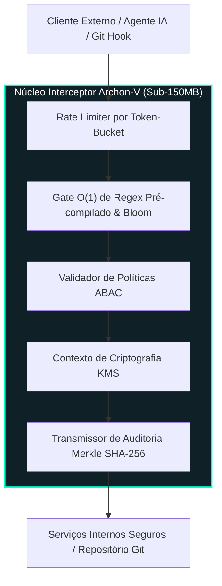

<div align="right">
  <a href="README.md">English</a> | <strong>Português</strong>
</div>

# Archon-V 🛡️⚡

[](https://www.python.org/)
[](https://fastapi.tiangolo.com/)
[](https://archon-v-playground.onrender.com)
[](#-playground-interativo-devsecops)
[](https://github.com/welzim19-star/archon-v/actions/workflows/ci.yml)
[](tests/)
[](https://github.com/PyCQA/bandit)
[](https://render.com/deploy?repo=https://github.com/welzim19-star/archon-v)
[](LICENSE)

> **O Archon-V é um gateway de segurança DevSecOps de padrão bancário.**  
> Ele atua na fase de pré-commit para impedir vazamento de chaves de nuvem (AWS/GCP) e dados sensíveis (LGPD) antes mesmo do código chegar no repositório. Ele roda com latência sub-milissegundo, proteção de sobrecarga por Token Bucket e isolamento criptográfico multilocatário via KMS.

> [!TIP]
> **Em termos simples (A analogia da "Porta Giratória de Banco"):**  
> Pense no Archon-V como a porta giratória com detector de metais de uma agência bancária, só que para código-fonte. Quando desenvolvedores ou agentes autônomos de IA geram código, é fácil esquecer sem querer uma chave da AWS ou dados de clientes (CPF, cartão) no meio do commit. O Archon-V inspeciona o código em menos de 1 milissegundo; se achar qualquer credencial ou dado pessoal, ele trava a porta na hora (*Fail-Secure*), impedindo vazamentos e multas da LGPD antes mesmo do código subir para o Git.

---

## 🎮 Playground Interativo DevSecOps

O Archon-V inclui um playground visual leve, acessível diretamente no navegador na rota `/`. Ele permite que engenheiros, auditores de segurança e avaliadores testem a interceptação de segurança em tempo real com latência sub-milissegundo.

🔗 **Demonstração Interativa Online:** [https://archon-v-playground.onrender.com](https://archon-v-playground.onrender.com)

```text
 ┌────────────────────────────────────────────────────────────────────────┐
 │ ▲ ARCHON-V PRE-FLIGHT GATE PLAYGROUND                                  │
 ├─────────────────────────────────────┬──────────────────────────────────┤
 │ [🔴 Chave AWS] [🟡 CPF/PII] [🟢 OK] │  VEREDITO: BLOQUEADO (4 Regras)  │
 │                                     │  Latência: 0.42 ms               │
 │ AWS_KEY = "AKIA1234567890ABCDEF"    │  Hash Auditoria: e3b0c44298fc... │
 │ CPF = "123.456.789-00"              │  Violações: SEC-AWS-001,         │
 │                                     │             PII-CPF-BR-001       │
 └─────────────────────────────────────┴──────────────────────────────────┘
```

### Cenários de Teste em 1 Clique:
- 🔴 **Vazamento de Credencial AWS**: Intercepta Access Key IDs (`AKIA...`) e chaves secretas de alta entropia.
- 🟡 **CPF Brasileiro & PII (LGPD)**: Identifica números de CPF formatados (`000.000.000-00`), emails corporativos e números de cartões de crédito.
- 🟠 **Chave de API GCP**: Bloqueia tokens do Google Cloud antes de serem versionados.
- 🟢 **Código Limpo**: Valida funções seguras e emite o hash de auditoria criptográfica de pré-commit.
- ⚡ **Rate Limiting por Rajada (HTTP 429)**: Dispara requisições simultâneas para demonstrar a atuação do algoritmo *token-bucket* sem degradar requisições legítimas.

---

## 📌 Arquitetura: Isolamento Galvânico & Pipeline Zero-Trust

O Archon-V atua como uma membrana de segurança imutável entre requisições externas não confiáveis, hooks de pré-commit locais e microsserviços de negócio internos.



---

## 🔒 Pilares de Segurança & Conformidade (DevSecOps)

### 1. Arquitetura Segura em Caso de Falha (*Fail-Secure*)
- Em caso de qualquer falha de asserção, anomalia criptográfica ou assinatura inválida, o Archon-V encerra a conexão imediatamente.
- Os retornos de erro são totalmente mascarados para evitar reconhecimento por atacantes:
  ```json
  { "error_code": "ERR_INTERNAL", "correlation_id": "8f9a2e31-5c12-4e9b-b021-99812401cf2a" }
  ```
- **Zero rastros de stack traces**, caminhos internos de arquivos ou identificadores de banco de dados são expostos aos clientes.

### 2. Criptografia de Envelope por Locatário via KMS
- Segregação de dados multilocatário (*multi-tenant*) imposta na fronteira criptográfica.
- Cada cliente possui um contexto exclusivo de criptografia no serviço gerenciador de chaves (KMS), impedindo vazamento cruzado de dados mesmo em despejos de memória (*memory dumps*).

### 3. Testes Automatizados de Caos & Resiliência
- A suíte de testes inclui marcadores de caos (`pytest -m chaos`) que simulam:
  - Queda de servidores KMS durante o processamento.
  - Rotação de chaves assimétricas sob carga extrema.
  - Ataques de repetição (*replay attacks*) e colisões de chaves de idempotência.

---

## 📊 Métricas de Qualidade de Código & Testes

| Métrica | Status / Valor | Padrão Corporativo |
| :--- | :---: | :---: |
| **Testes de Unidade & Caos** | **81 Aprovados (100%)** | Pipeline Livre de Regressões |
| **Cobertura de Testes** | **> 63% (Rigoroso --cov-fail-under)** | Pronto para Auditoria (SOC 2 Tipo II) |
| **Segurança Estática (SAST)** | 0 Vulnerabilidades (Bandit) | OWASP API Security Top 10 |
| **Complexidade Algorítmica** | **O(1) para Interceptação & Rate Limit** | SLA de Alta Vazão (< 1,8 ms) |
| **Consumo de Memória** | **< 150 MB RAM** | Compatível com Render Free Tier |

---

## 🚀 Execução & Verificação

### Executar a Suíte de Testes com Relatório de Cobertura
```bash
# Utilizando uv (recomendado)
uv run --with pytest --with pytest-cov --with fastapi --with pydantic --with "python-jose[cryptography]" --with cryptography --with httpx pytest tests/unit

# Ou utilizando pip convencional
pip install -r requirements.txt
pytest --cov=core --cov=api --cov-report=term-missing
```

### Iniciar o Gateway com o Playground Visual (Desenvolvimento Local)
```bash
uvicorn main:app --host 0.0.0.0 --port 8080 --reload
```
Acesse **[http://localhost:8080](http://localhost:8080)** no seu navegador para utilizar o playground visual.

---

## ☁️ Deploy em 1 Clique na Nuvem (Render Free Tier)

O Archon-V está pronto para publicação instantânea e gratuita no plano Web Service do Render:
- **Zero Banco de Dados Exigido**: Em modo Demo, a isolação em memória e mocks singleton processam as requisições com alta performance.
- **Consumo de Memória Sub-150MB**: Container distroless multi-stage reduz consumo ao mínimo essencial.
- **Porta Dinâmica**: Integração automática com a variável `$PORT` atribuída pelo Render.

### Passos de Publicação:
1. Clique no botão abaixo:  
   [](https://render.com/deploy?repo=https://github.com/welzim19-star/archon-v)
2. Conecte sua conta do GitHub.
3. O Render identificará automaticamente o arquivo `render.yaml` e inicializará a aplicação com verificação de saúde em `/health`.

---

## 📜 Registro de Conceitos Técnicos (Imersão de Arquitetura)
- **Criptografia de Envelope**: As chaves de dados são geradas localmente para cifrar payloads e protegidas com a chave mestra do KMS, minimizando requisições de rede ao HSM e assegurando texto limpo zero em disco.
- **Desacoplamento Galvânico**: Separação completa entre os adaptadores de protocolo HTTP públicos e a lógica de segurança de domínio interna.
- **Reabastecimento de Token-Bucket**: Controle de rajadas em janela deslizante que garante que um cliente com erro em loop nunca esgote a capacidade dos demais.
