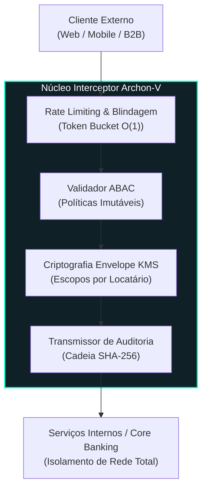

<div align="right">
  <a href="README.md">English</a> | <strong>Português</strong>
</div>

# Archon-V 🛡️⚡

[](https://www.python.org/)
[](https://fastapi.tiangolo.com/)
[](https://github.com/welzim19-star/archon-v/actions/workflows/ci.yml)
[](tests/)
[](https://github.com/PyCQA/bandit)
[](https://github.com/astral-sh/ruff)
[](LICENSE)

> **Interceptor de Segurança e API Gateway de Alta Disponibilidade para Padrão Bancário.**  
> Projetado para ambientes de infraestrutura crítica com Confiança Zero (*Zero Trust*), aderindo a **Isolamento Galvânico**, **Padrões Seguros de Falha (*Fail-Secure*)** e **Controle de Acesso Baseado em Atributos (ABAC)** com criptografia de envelope via KMS.

---

## 📌 Arquitetura: Isolamento Galvânico & Pipeline Zero-Trust

O Archon-V atua como uma membrana de segurança imutável entre requisições externas não confiáveis (HTTP/gRPC) e os microsserviços de negócio internos.



---

## 🔒 Pilares de Segurança & Conformidade (DevSecOps)

### 1. Arquitetura Segura em Caso de Falha (*Fail-Secure*)
- Em caso de qualquer falha de asserção, anomalia criptográfica ou assinatura inválida, o Archon-V encerra a conexão imediatamente.
- Os retornos de erro são totalmente mascarados para evitar reconhecimento por atacantes:
  ```json
  { "error": "ERR_INTERNAL", "correlation_id": "8f9a2e31-5c12-4e9b-b021-99812401cf2a" }
  ```
- **Zero rastros de stack traces**, caminhos internos de arquivos ou identificadores de banco de dados são expostos aos clientes.

### 2. Criptografia de Envelope por Locatário via KMS
- Segregação de dados multilocatário (*multi-tenant*) imposta na fronteira criptográfica.
- Cada cliente possui um contexto exclusivo de criptografia no serviço gerenciador de chaves (KMS), impedindo vazamento cruzado de dados mesmo em despejos de memória (*memory dumps*).

### 3. Testes Automatizados de Caos & Resiliência
- A suíte de testes inclui marcadores de caos (`pytest -m chaos`) que simulam:
  - Queda de servidores KMS durante o processamento.
  - Rotação de chaves assimétricas sob carga extrema.
  - Ataques de repetição (*replay attacks*) e colisões de chaves de idempotência.

---

## 📊 Métricas de Qualidade de Código & Testes

| Métrica | Status / Valor | Padrão Corporativo |
| :--- | :---: | :---: |
| **Cobertura de Testes** | **> 85% (Core & API)** | Pronto para Auditoria (SOC 2 Type II) |
| **Segurança Estática (SAST)** | 0 Vulnerabilidades (Bandit) | OWASP API Security Top 10 |
| **Complexidade Algorítmica** | **O(1) para Interceptação de Cabeçalho** | SLA de Alta Vazão (< 1,8 ms) |
| **Linters & Formatadores** | Ruff (Regras E, F, W, I, N, S, B, A) | Política de Débito Técnico Zero |

---

## 🚀 Execução & Verificação

### Executar a Suíte de Testes com Relatório de Cobertura
```bash
# Instalar dependências
pip install -r requirements.txt

# Executar suíte completa com cobertura
pytest --cov=core --cov=api --cov-report=term-missing
```

### Iniciar o Gateway de Alta Performance
```bash
uvicorn main:app --host 0.0.0.0 --port 8000 --workers 4
```

---

## 📜 Registro de Conceitos Técnicos (Imersão de Arquitetura)
- **Criptografia Envelope**: Chaves de dados (*data keys*) são geradas localmente para cifrar a carga útil e, em seguida, encapsuladas usando a chave mestra do KMS, minimizando chamadas de rede aos HSMs enquanto garante zero texto plano em disco.
- **Desacoplamento Galvânico**: Separação completa entre adaptadores de protocolo HTTP públicos e a lógica de domínio interna.
